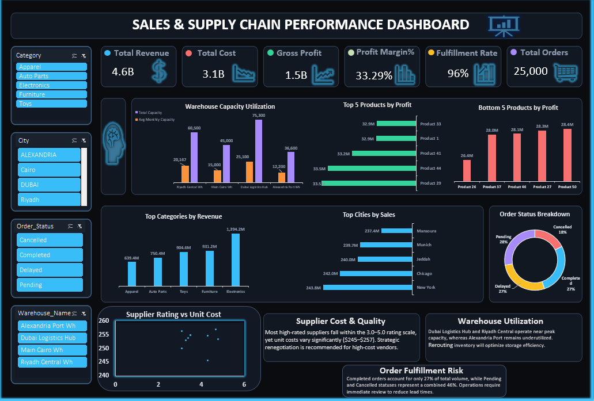

# 📊 Sales & Supply Chain Analytics Dashboard

**An Excel-based Business Intelligence project for analyzing sales performance, profitability, warehouse utilization, supplier performance, and order fulfillment.**

[📥 Download Excel Dashboard](supplychain.xlsx)

---

## 🖼️ Dashboard Preview

---

## 📌 Project Overview

The Sales & Supply Chain Analytics Dashboard is an interactive Microsoft Excel dashboard designed to transform business data into meaningful insights.

It provides a centralized view of sales, costs, profitability, warehouse capacity, supplier ratings, and order statuses to support data-driven business decisions.

The dashboard includes interactive filters that allow users to explore performance across product categories, cities, order statuses, and warehouses.

## 🎯 Business Problem

Businesses need a clear understanding of their sales performance and supply chain operations to identify inefficiencies, control costs, and improve profitability.

Without a centralized analytical view, decision-makers may struggle to identify underperforming products, warehouse capacity issues, supplier cost differences, and order fulfillment risks.

**Solution:** An interactive dashboard that consolidates key performance indicators and visual analytics into one report.

## 🛠️ Tools & Technologies

* Microsoft Excel
* Data Analysis
* Data Visualization
* KPI Reporting
* Interactive Slicers & Filters
* Business Intelligence
* Supply Chain Analytics

## 📈 Key Performance Indicators (KPIs)

| KPI              | Reported Value | Business Purpose                         |
| ---------------- | -------------: | ---------------------------------------- |
| Total Revenue    |           4.6B | Monitor overall sales performance        |
| Total Cost       |           3.1B | Track business costs                     |
| Gross Profit     |           1.5B | Evaluate financial performance           |
| Profit Margin    |         33.29% | Assess profitability relative to revenue |
| Fulfillment Rate |            96% | Monitor order fulfillment                |
| Total Orders     |         25,000 | Measure order volume                     |

*Values are taken from the dashboard display. Their definitions and calculations should be validated against the underlying dataset.*

## 📊 Dashboard Analysis

### 1. Sales Performance

* Compare revenue across product categories.
* Identify leading categories by revenue.
* Analyze sales distribution across cities.

### 2. Product Profitability

* Identify the top five products by profit.
* Examine the bottom five products by profit.
* Support further investigation into product performance and pricing.

### 3. Warehouse Capacity Utilization

* Compare warehouse capacity with average monthly capacity.
* Identify warehouses that may require closer monitoring.
* Support inventory allocation and warehouse planning.

### 4. Supplier Cost & Quality

* Explore the relationship between supplier ratings and unit costs.
* Identify potential opportunities to balance quality and procurement costs.
* Support supplier evaluation and negotiation decisions.

### 5. Order Status & Fulfillment

* Monitor completed, pending, delayed, and cancelled orders.
* Examine the distribution of order statuses.
* Identify areas requiring further operational investigation.

## 💡 Key Business Insights

Based on the figures and visualizations displayed in the dashboard:

* **Profitability:** The dashboard reports a gross profit of 1.5B and a profit margin of 33.29%.
* **Fulfillment:** The reported fulfillment rate is 96%, making fulfillment performance an important metric to monitor.
* **Warehouse Operations:** Differences in warehouse capacity utilization can help identify opportunities for better inventory distribution.
* **Supplier Management:** Supplier ratings and unit costs can be analyzed together to evaluate procurement trade-offs.
* **Order Management:** Pending, delayed, and cancelled orders should be investigated to identify possible operational bottlenecks.

*These are preliminary observations from the dashboard visualization. Confirm the underlying calculations and source data before treating them as final business findings.*

## 🎛️ Interactive Filters

The dashboard includes filters for:

* Product Category
* City
* Order Status
* Warehouse Name

These filters allow users to explore different business segments and investigate performance variations.

## 💼 Business Value

The dashboard supports business stakeholders by helping them:

* Monitor sales and profitability.
* Identify products that require further analysis.
* Improve warehouse capacity planning.
* Evaluate supplier cost and quality.
* Monitor fulfillment performance.
* Make more informed operational decisions.

## 🚀 Future Improvements

* Add monthly and quarterly sales trend analysis.
* Include on-time delivery and average lead-time KPIs.
* Develop inventory stockout monitoring.
* Create a supplier performance scorecard.
* Validate KPI calculations against the original dataset.

## 👤 Author

**Abdo Magdy**

Aspiring Data Analyst | Business Intelligence | Data Visualization
